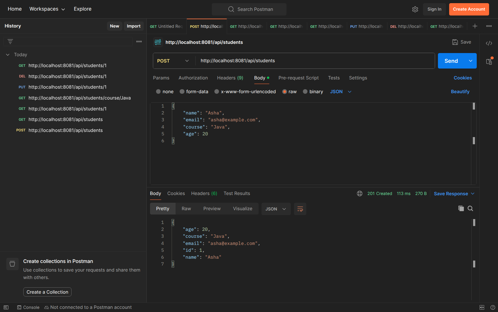
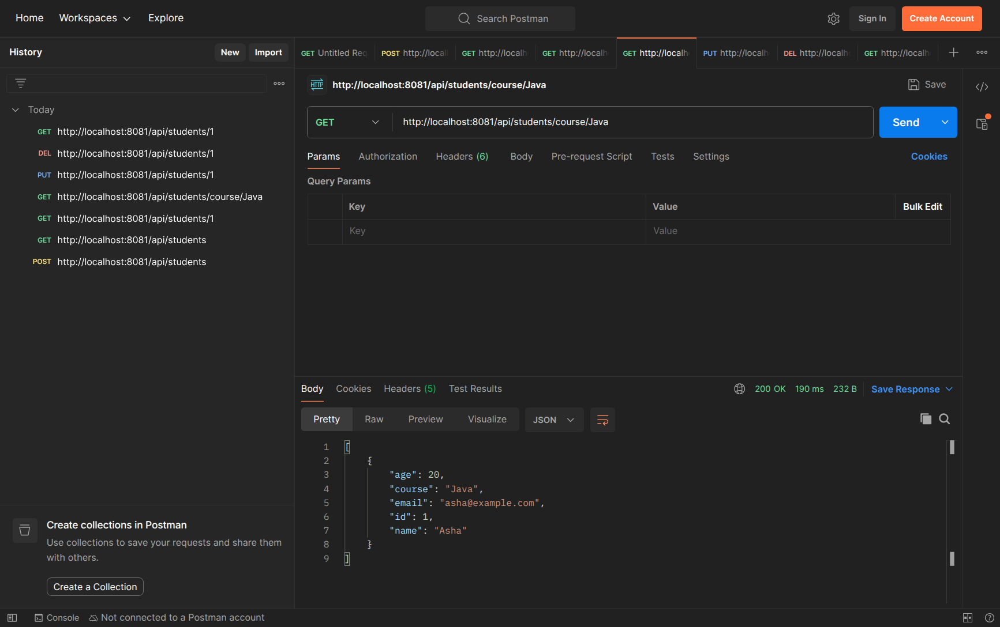
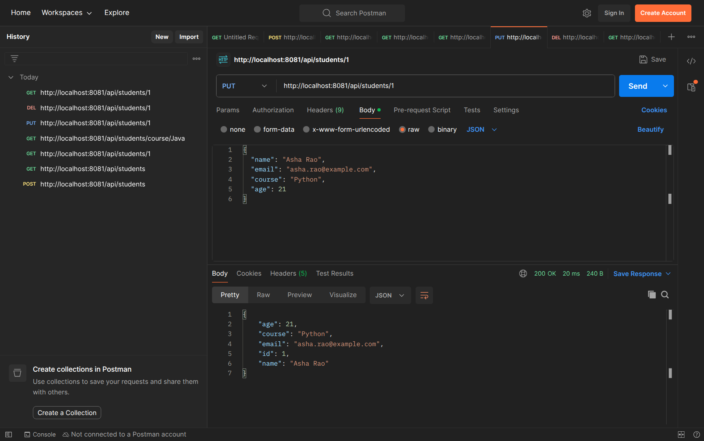
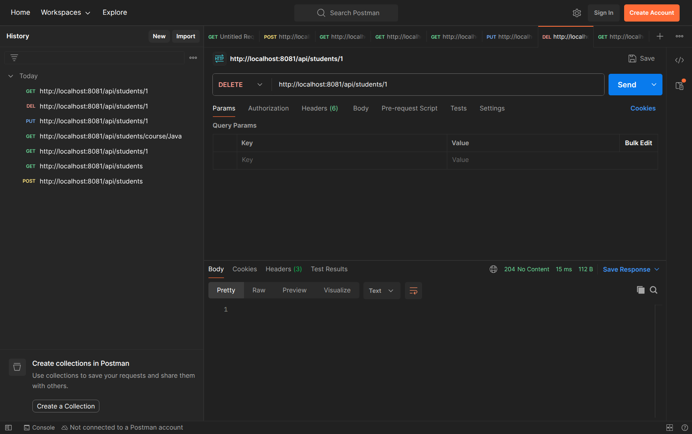
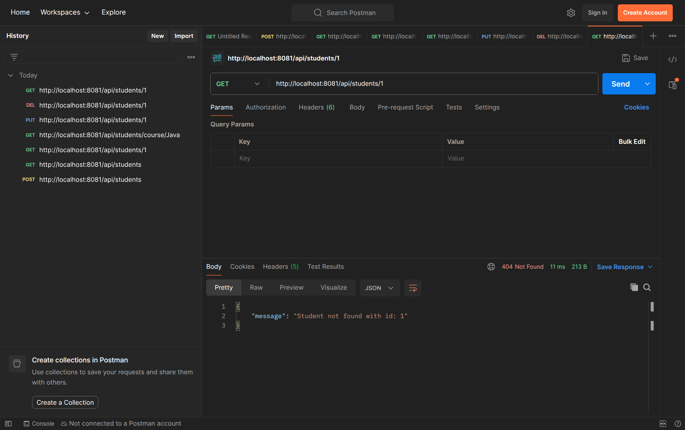

# Student Management REST API

A simple Spring Boot application using Spring Data JPA and MySQL.
Requires Java 17 or newer, Maven, and MySQL.

## Run

1. Start MySQL and create the database:

   ```bash
   mysql -u root -p < database.sql
   ```

2. Set your database credentials and start the application:

   ```bash
   export DB_USERNAME=root
   export DB_PASSWORD='your-mysql-password'
   mvn spring-boot:run
   ```

   The default database URL is `jdbc:mysql://localhost:3306/student_management`.
   Set `DB_URL` if your database runs elsewhere. Hibernate creates the student table.

The API runs at `http://localhost:8080`.

## Endpoints

| Method | URL | Success status |
| --- | --- | --- |
| POST | `/api/students` | 201 Created |
| GET | `/api/students` | 200 OK |
| GET | `/api/students/{id}` | 200 OK |
| PUT | `/api/students/{id}` | 200 OK |
| DELETE | `/api/students/{id}` | 204 No Content |
| GET | `/api/students/course/{course}` | 200 OK |

Use this JSON body for POST and PUT, with `Content-Type: application/json`:

```json
{
  "name": "Asha",
  "email": "asha@example.com",
  "course": "Java",
  "age": 20
}
```

IDs are generated automatically. PUT replaces all four student details.
Course searches ignore case and return an empty list when nothing matches.
GET, PUT, and DELETE return 404 for a missing student:

```json
{"message": "Student not found with id: 1"}
```

## Check the API

```bash
mvn test
```

The integration test covers all six endpoints and missing-student responses using
an isolated H2 database. The application uses MySQL when run normally.

For the assignment's Postman checks:

1. Import `postman/Student_Management.postman_collection.json` into Postman.
2. Start the application with MySQL and run requests in numbered order.
3. The first request saves the generated ID for later requests.
4. Check the response and status code. DELETE returns an empty response body.

The collection includes status checks and an additional 404 example.

## Postman screenshots

These requests were tested against MySQL. The screenshots use API port 8081;
the application defaults to port 8080.

### Add a student — 201 Created



### Get all students — 200 OK


### Get a student by ID — 200 OK


### Get students by course — 200 OK



### Update a student — 200 OK



### Delete a student — 204 No Content



### Student not found — 404 Not Found


